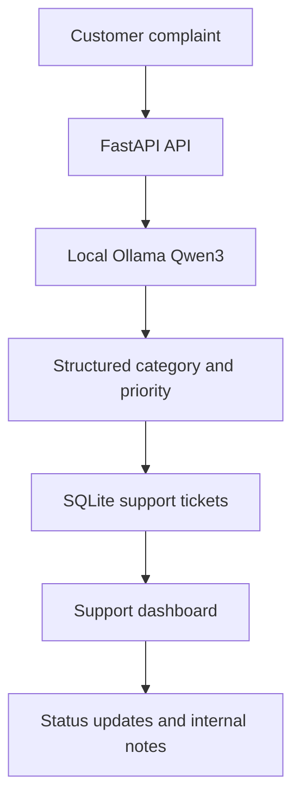

# ResolveFlow AI

**Local AI-powered customer support ticket manager** built with Python, FastAPI, SQLite, vanilla JavaScript, and Ollama's Qwen3 model.

ResolveFlow AI transforms incoming customer complaints into categorized, prioritized support tickets and gives support staff a dashboard to track them from intake to resolution. It is a functional **local portfolio MVP**, not a public production service.

## What it demonstrates

- **AI-powered intake:** Qwen3 classifies support requests into Billing, Technical Support, Delivery, or General Inquiry, with a priority and short explanation.
- **Human-in-the-loop workflow:** Staff review AI classifications, search and filter tickets, update ticket statuses, and save persistent internal notes.
- **Backend engineering:** FastAPI REST endpoints, Pydantic validation, and SQLite persistence.
- **Authentication and access control:** Argon2 password hashing, hashed server-side sessions, HTTP-only cookies, CSRF checks, and Admin/Agent roles.
- **Testability:** Seven offline integration tests cover the ticket workflow, authentication, access checks, CSRF behavior, and mocked AI classification.

## Architecture



**Stack:** Python · FastAPI · SQLite · Ollama · Qwen3 · JavaScript · HTML/CSS · Argon2 · pytest

## Run locally

You need **Python 3.10+**, **Ollama**, and a local copy of `qwen3:1.7b` (the model download is separate from this repository).

### Windows PowerShell

```powershell
py -3 -m venv .venv
.\.venv\Scripts\python.exe -m pip install -r requirements.txt
ollama pull qwen3:1.7b
.\.venv\Scripts\python.exe create_user.py --username admin --role admin
.\.venv\Scripts\python.exe -m uvicorn main:app --host 127.0.0.1 --port 8000
```

Make sure Ollama is running on `http://127.0.0.1:11434` (launch the Ollama application or run `ollama serve` separately). Open **http://127.0.0.1:8000/login** and sign in with the account you created. The user-creation script prompts securely for a password.

For an **existing installation**, keep your `resolveflow.db` and `.venv` intact. Do not run `create_user.py` again if you already have an administrator account.

## Five-minute demonstration

1. Sign in to the dashboard using an account created locally.
2. Create a fictional customer complaint such as *“I was charged twice for my subscription.”* Show Qwen3's category and priority decision.
3. Search for the ticket and change its status to **In Progress**.
4. Open the ticket, save an internal note, close and reopen it, and verify the note persists.
5. Log out, revisit `/dashboard`, and verify that authentication is required.

**Local validation:** All five manual functional checks were reported as passed during project acceptance (login, live AI ticket creation, status update, note persistence, logout). The test suite also passes offline with a mocked Ollama response.

## Run tests

```powershell
.\.venv\Scripts\python.exe -m pytest -q
```

Expected result: **7 passed**. Tests use isolated temporary SQLite databases, not the live application database. Continuous integration also runs the offline tests on each push and pull request.

## Project files

| Path | Purpose |
| --- | --- |
| `main.py` | FastAPI endpoints, AI request handling, and access checks |
| `database.py` | SQLite schema and ticket/note persistence |
| `auth.py` | Authentication, session handling, CSRF token generation |
| `frontend/` | HTML/CSS/JavaScript dashboard and login |
| `create_user.py` | Interactive local staff account creation |
| `tests/test_app.py` | Integration tests with mocked Ollama |
| `docs/architecture.md` | Technical architecture details |
| `docs/portfolio_description.md` | Project summary for portfolio/resume use |

## Security and project scope

This application is designed for **local demonstration only**. Do not run it as a publicly exposed server without additional security and deployment work, including HTTPS configuration, rate limiting, improved authorization policies, security headers, monitoring, and a comprehensive review.

Never commit your database, `.env` file, passwords, API tokens, or real customer information. `.gitignore` excludes common sensitive local files.

**Status:** Local MVP complete and functionally validated. Public deployment has not been audited or approved.
